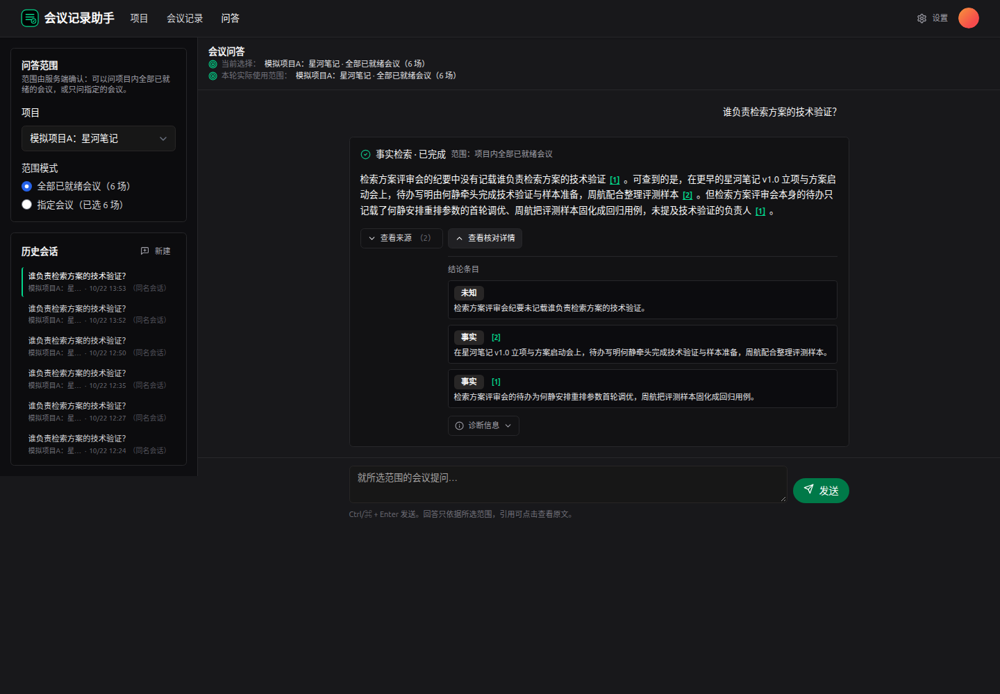
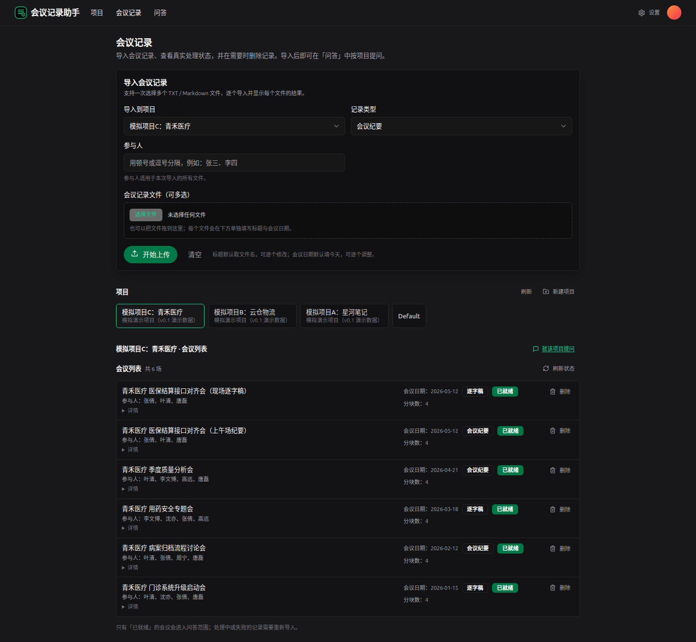
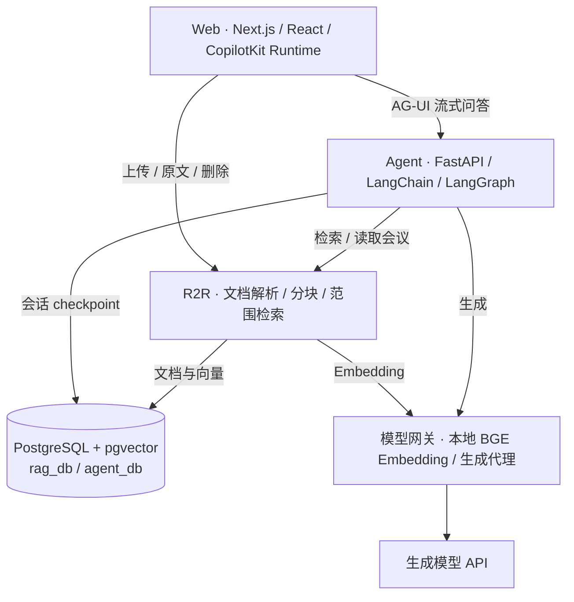

# meeting-records-agent · 会议记录助手

导入一个项目的多次会议记录，查清**最后怎么定、谁负责、为什么改**，并点开引用核对原文。

[安装运行](docs/usage/install.md) · [演示步骤](docs/usage/demo.md) · [版本状态](docs/releases/v0.1.1-preview.md) · [详细设计](docs/design-v0.1.md)



*本地运行截图，内容来自仓库内的模拟会议数据。当前为 v0.1.1 预览版，面向个人本地使用。*

## 可以问什么

| 问题 | 处理方式 |
|---|---|
| 检索方案最后采用了哪个？ | 按会议日期核对提议、确认和后续变更，列出依据 |
| 最新会议又建议换方案，是已经改了吗？ | 区分重新提议与明确决议，说明是否存在覆盖此前决定的证据 |
| 谁负责技术验证，记录里说完成了吗？ | 查询分工与进度；没有记载时说明未知 |
| 为什么从方案 A 改成 B？ | 对照变更前后的记录，引用讨论理由与确认内容 |

支持批量导入 UTF-8 TXT / Markdown、按项目或指定会议提问、查看原文来源、恢复历史会话。删除记录后，新回答不再检索它，旧引用标记失效。

<details>
<summary>查看会议记录管理界面</summary>



</details>

## 本地运行

当前验证路径是 **Linux 本机进程部署**。需要 Python 3.12、uv、Node.js 22、pnpm 和生成模型 API；PostgreSQL 安装脚本依赖 Debian / Ubuntu 软件包工具与 PostgreSQL 18 软件源。完整前提和命令见[安装文档](docs/usage/install.md)。

```bash
git clone https://github.com/mmm-05610/meeting-records-agent.git
cd meeting-records-agent
cp .env.example .env
cp apps/web/.env.local.example apps/web/.env.local
```

1. 按安装文档配置密钥与本地账号，保持两份环境文件中的账号配置一致。
2. 安装依赖，启动数据库、模型网关、R2R、Agent 和 Web。
3. 打开 <http://127.0.0.1:3000>，登录后导入自己的会议记录，或使用[内置演示数据](docs/usage/demo.md)。

**建议先试这个问题：**“星河笔记 v1.0 的检索方案最后怎么定的？最新会议重新建议改回标签过滤方案，会影响当前决定吗？”

演示记录中，3 月确认了混合检索，5 月只是重新提出替代建议。可以据此检查回答是否把“最新提议”误当成“最终决定”。

## 怎么实现

事实类问题走**向量检索 → BGE 重排 → 带引用回答**；决定与变更类问题在预算内分页读取所选会议，逐场核对后按日期整理。超出阅读预算时提示缩小范围。



| 模块 | 基于什么 | 本项目的改造 |
|---|---|---|
| Agent | [agent-service-toolkit](https://github.com/JoshuaC215/agent-service-toolkit) | 会议范围约束、事实与决定两条路径、结构化回答和引用 |
| 文档与检索 | [R2R](https://github.com/SciPhi-AI/R2R) | 会议元数据、项目隔离、原文定位、导入与删除适配 |
| Web 与交互 | [R2R-Application](https://github.com/SciPhi-AI/R2R-Application) + [CopilotKit](https://github.com/CopilotKit/CopilotKit) | 批量导入、范围选择、流式状态、来源面板、历史回答匹配 |
| 向量与重排 | [FastEmbed](https://github.com/qdrant/fastembed) + BGE | 本地中文向量模型与交叉编码器重排；FlashRank 为可选后端 |
| 离线评测 | [Ragas](https://github.com/vibrantlabsai/ragas) + 规则检查 | 冻结题集、三组策略对照与来源核验；Ragas 目前仅完成少量样本试跑 |

源码按 `apps/web`、`apps/agent`、`apps/rag` 分开；模型适配在 `services/model-gateway`，数据与评测在 `evals`。上游版本、许可和采用边界见[来源记录](docs/upstream.md)。

## 验证与边界

- 内置 **3 个模拟项目、18 份会议、36 道问题**，其中 24 道为冻结测试题；对照纯向量、加入重排、加入完整会议核对三种策略。[评测报告](docs/evidence/evaluation-summary-v0.1.1.md)保留失败题与坏例，关键词命中不等同于答案准确率。
- 历史回答匹配与接口契约已有[检查记录](docs/releases/v0.1.1-preview.md#验证记录)。Ragas 仅试跑 2 个样本，含判分失败；完整 Docker Compose 部署仍待验证。
- 首版只处理已有文字记录，采用本地单账号；语音转写、自动入会和团队协作暂未提供。生成环节需要外部模型 API。

## 文档与许可

[安装与配置](docs/usage/install.md) · [演示数据](docs/usage/demo.md) · [备份与恢复](docs/usage/operations.md) · [架构与模块](specs/001-v0.1/design/architecture.md) · [接口契约](specs/001-v0.1/contracts/interfaces.md)

[MIT License](LICENSE)。本项目基于上述开源项目二次开发，保留各上游许可与版权声明，详见[许可清单](docs/upstream/licenses.md)。
