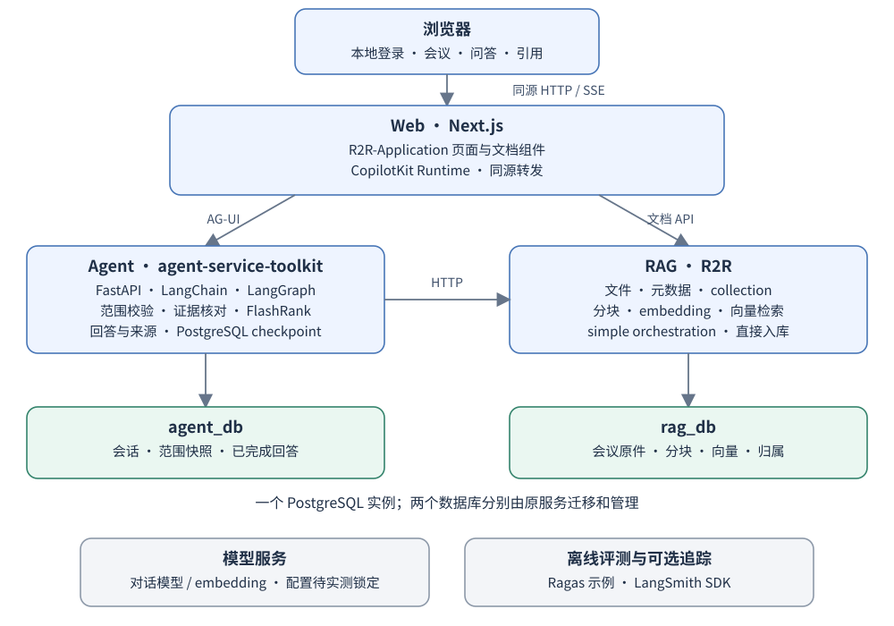

# meeting-records-agent

会议记录问答助手：导入一个项目的多次会议记录，查清“最后怎么定的、谁负责、为什么改了”，并通过引用核对原文。

**当前状态：v0.1 已实现并在本机真实链路验证。** 三个应用基于固定上游二次开发，可在本机安装、导入中文会议记录、跨会议问答并逐项核对引用；评测、验收证据与已知限制见
[docs/evidence/v0.1-acceptance.md](docs/evidence/v0.1-acceptance.md) 与 [docs/evidence/evaluation-summary.md](docs/evidence/evaluation-summary.md)。

## v0.1 要做什么

- 导入 UTF-8 TXT、Markdown，填写会议名称、日期和记录类型。
- 按项目或指定会议提问，查询事实、分工、决定及变更原因。
- 区分提议、明确确认、后续变更和记录冲突；缺少依据时说明未知。
- 从回答逐项打开引用，查看对应会议原文。
- 保存会话、查询范围与来源；移除记录后，新回答不再使用它。

首版面向个人本地使用，处理已有文字记录。语音转写、自动入会、会议平台同步、团队共享和任务派发不在 v0.1 范围内。

## 技术架构与二次开发来源



| 部分 | 基于什么改造 | 主要改动 |
|---|---|---|
| Agent 服务 | [agent-service-toolkit](https://github.com/JoshuaC215/agent-service-toolkit) · Python、FastAPI、LangChain、LangGraph | 会议范围、事实检索与决定核对两条路径、引用和历史响应 |
| 文档与检索 | [R2R](https://github.com/SciPhi-AI/R2R) · PostgreSQL、pgvector | 会议元数据、配置裁剪、导入与删除流程适配 |
| Web | [R2R-Application](https://github.com/SciPhi-AI/R2R-Application) · TypeScript、Next.js、React | 会议列表、范围选择、上传和来源展示 |
| 聊天交互 | [CopilotKit 官方 LangGraph FastAPI 示例](https://github.com/CopilotKit/CopilotKit/tree/abc6807f35865e043c498398e3080f137ddbdad9/examples/integrations/langgraph-fastapi) · AG-UI | 接入现有 Web，传递查询范围、回答与引用 |
| 重排 | LangChain FlashrankRerank、FlashRank | 配置模型和预算，保留文档、分块标识 |
| 离线评测 | [Ragas 官方示例](https://github.com/vibrantlabsai/ragas/tree/298b68274234c060deacab3cf5fb52aa3a20e885/examples) | 模拟会议、标准答案、引用与决定判断用例 |
| 可选追踪 | LangSmith SDK | 默认关闭，按需配置 trace |

功能模块以现有项目二次开发和组件集成为基础。接口适配、提示词、配置及既有流程修改仍需实现；不会另建会议管理后端、工作流引擎或聊天框架。LangGraph 负责唯一的 Agent 编排，Agent 和 R2R 使用独立 Python 环境并通过 HTTP 通信。

## 文档

- [v0.1 详细设计](docs/design-v0.1.md)：功能、流程、数据、接口、部署目标、目录、评测与验收。
- [上游来源与采用方式](docs/upstream.md)：采用边界、固定版本及待验证事项。
- [上游版本记录](upstream-lock.yaml)：选型基线，尚不是已安装依赖的锁文件。
- 图示：[页面布局](docs/assets/workspace.svg)、[Agent 流程](docs/assets/agent.svg)、[导入流程](docs/assets/ingestion.svg)。

## 当前怎么使用

```bash
git clone https://github.com/mmm-05610/meeting-records-agent.git
cd meeting-records-agent
cp .env.example .env         # 填入 OPENCODE_GO_API_KEY 等
bash scripts/native/install-postgres.sh
bash scripts/native/init-db.sh
# 依赖安装与启动见 docs/usage/install.md
```

- 安装/配置/启动/停止/备份恢复：[docs/usage/install.md](docs/usage/install.md)、[docs/usage/operations.md](docs/usage/operations.md)
- 三份演示记录与体验步骤：[docs/usage/demo.md](docs/usage/demo.md)
- 交付形态的 Compose（本机无 Docker 守护进程，未实跑）：[deployment/docker-compose.yaml](deployment/docker-compose.yaml)

本机实际验证的是 native 模式（PostgreSQL 18 + pgvector、模型网关、R2R、Agent、Web 五个进程）；
Web 仅监听 `127.0.0.1:3000`，登录使用本地单账号。

## 实施顺序

1. **运行与导入**：基于上游启动服务，一份中文会议记录完成入库、状态查询和原文读取。
2. **检索与来源**：真实检索、重排、回答与引用点击形成闭环。
3. **决定与变更**：验证“提议不等于确认”和前后变更的证据判断。
4. **会话与维护**：连续追问、刷新与重启恢复、删除及失效引用。
5. **评测与交付**：冻结题集、记录实际结果，完成可复现安装与演示。

## 版本与许可

上游固定到已研究的提交，实际引入方式、许可与修改记录见 [来源记录](docs/upstream.md) 与
[补丁记录](docs/upstream/patches.md)。三个二开目录保留各自 MIT 许可；本项目自身以 MIT 许可发布
（见 [LICENSE](LICENSE)），模拟评测数据与结果仅用于本地验证。

## 实施包与 dsh 执行入口

第一版实施包位于 [specs/001-v0.1](specs/001-v0.1/README.md)。执行进展、任务状态与验收结果：
[docs/evidence/v0.1-acceptance.md](docs/evidence/v0.1-acceptance.md)；夜间恢复调度回执在本地 `.run/v0.1/`（不提交）。

- [架构与模块](specs/001-v0.1/design/architecture.md) · [模块详细设计](specs/001-v0.1/design/modules.md) · [接口契约](specs/001-v0.1/contracts/interfaces.md)
- [任务与依赖图](specs/001-v0.1/tasks.md) · [最终验收](specs/001-v0.1/acceptance/checklist.md)
- [完整 dsh /goal](specs/001-v0.1/dsh-goal.md) · [北京时间 01:30–09:30 恢复检查](specs/001-v0.1/operations/resume.md)

在仓库根目录发起执行者；运行状态与调度回执留在被忽略的 `.run/`，不提交到公开仓库。
