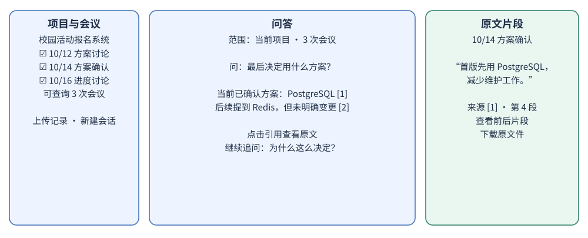
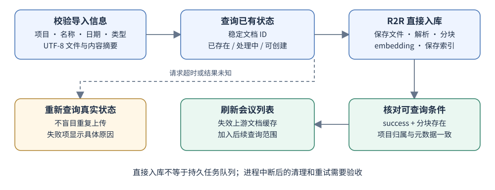
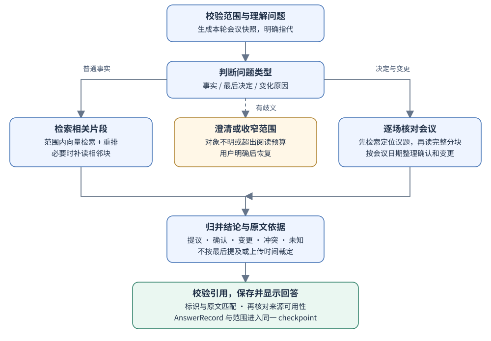

# 会议记录问答助手 v0.1 详细设计

设计修订：D0.1-r1 · 2026-10-21 · 状态：v0.1 设计基线，产品尚未实施。

导入一个项目的多次会议记录，查询最后确认的决定、人员分工和变更原因，并逐项核对原文。首版面向个人本地使用。本文描述目标行为与验收条件；当前仓库处于文档与项目初始化阶段。

本设计采用三个应用服务、一个 PostgreSQL 实例，功能模块基于现有开源项目二次开发。固定来源见第 13 节和 upstream.md。

## 1 产品范围与完成标准

首版完成一条闭环：安装配置 → 登录本地账号 → 创建项目分组 → 导入记录 → 选定会议提问 → 核对来源 → 追加新会议后再次提问 → 重启后恢复记录与会话。

| ID | 首版需求 | 可见结果 | 对应验收 |
|---|---|---|---|
| F01 | 导入 UTF-8 TXT、Markdown | 填写会议名称和日期，显示逐文件处理状态 | T01、T02 |
| F02 | 按项目和指定会议限定范围 | 问答页显示项目、会议数量及日期范围 | T03、T14 |
| F03 | 跨会议查事实、负责人、截止日期 | 回答来自选定范围的记录，缺失字段明确标出 | T04、T07 |
| F04 | 查最后确认的决定 | 区分提议、确认、变更、未决和冲突 | T05、T06、T17 |
| F05 | 解释决定或分工的变化 | 给出前后证据；没有明确原因时不补写原因 | T06、T08 |
| F06 | 逐项查看引用 | 从结论打开对应会议原文片段 | T09、T10 |
| F07 | 连续追问与必要澄清 | 能理解当前话题；有歧义时先明确对象 | T11 |
| F08 | 正常重启后恢复 | 会议、对话、当时的查询范围和引用仍可查看 | T12 |
| F09 | 移除错误记录 | 新提问不再使用该记录，旧回答标注来源失效 | T13 |
| F10 | 离线评测与故障诊断 | 可复跑案例，记录检索、引用、判断和耗时结果 | T15、T16、T18 |

本版输入是已有文字记录。录音、语音转写、自动入会、外部会议平台同步、团队共享、任务自动派发、独立议题时间线和“截至某历史时点”的专门查询留到后续版本。首版可以选择特定会议，但不将这一操作包装成完整的历史状态查询功能。

“会议记录”可以是逐字转录，也可以是人工纪要；录入时标明类型。引用只证明输入记录里写了什么，不能把一份简略纪要解释为完整还原了实际会议。

## 2 页面与使用流程

### 2.1 页面结构

| 页面或区域 | 用户看到什么 | 主要操作 | 二开来源 |
|---|---|---|---|
| 登录页 | 一个本地账号登录入口 | 使用安装时配置的账号登录 | R2R-Application 既有登录页与 UserContext |
| 项目与会议列表 | 项目选择、会议名称、会议日期、记录类型、状态 | 新建项目分组、上传、选择会议、查看、移除 | collections、documents、DocumentsTable |
| 导入弹窗 | 文件列表，每个文件对应名称、日期、记录类型 | 补齐信息后逐个导入 | UploadDialog、upload |
| 问答页 | 当前范围、历史对话、提问框、进度、回答 | 新建会话、提问、追问、切换范围 | chat、CopilotKit headless-chat |
| 来源区域 | 会议名、日期、引用片段及上下文 | 点击引用、查看相邻片段、下载原文件 | answer、SearchResults、documentDialogInfo |

保留单账号登录是本次部署细节建议，复用上游已有能力；不增加注册、邀请或权限管理产品流程。模型配置保存在服务端配置文件中，首版不另做模型管理后台。



宽屏采用会议范围、问答、原文三栏；窄屏把会议范围和原文放进现有抽屉或弹窗。来源入口必须键盘可操作。空项目显示导入入口；未选择会议时不发起模型调用。错误信息放在实际失败的文件或回答旁。

### 2.2 导入交互

1. 选择项目，上传 TXT 或 Markdown。项目对应已有 R2R collection，不增加独立项目数据库。
2. 每份文件必须有会议名称、会议日期和记录类型；参与人可选。文件名可以预填名称，但不能自动当成可信会议日期。
3. 点击导入后逐文件提交。页面显示“正在处理”“可查询”或“处理失败”；第一版只显示真实阶段，不显示虚假的百分比进度。
4. “可查询”要求文档入库成功、分块存在、项目归属核对成功。只收到上传响应不能直接标绿。
5. 失败项保留名称和错误原因；重试前先查询服务器状态。刷新网页后重新读取状态，不依赖浏览器内存判断任务成功。

随产品提供三份明确标注为模拟数据的示例文件，通过同一个上传入口使用。示例不自动写入真实项目，也不额外建设演示数据管理模块。

### 2.3 查询范围与会话

范围有两种：项目内全部可查询会议，或用户明确选中的会议。默认进入单个项目，不跨项目搜索。每轮显示“本轮依据：项目名，N 次会议，起止日期”。

项目全部模式在每轮开始时重新列出已就绪会议，因此新导入的会议会进入下一轮。指定会议模式只包含选中的 ID，新会议不会悄悄加入。项目或选择模式发生变化时开启新会话，避免旧话题混入新范围；旧会话保留。

每轮使用独立范围快照，问答过程中新增的会议留到下一轮。运行中移除了来源时，在发布最终答案前重新核对；范围已变化则提示重新提问，不能发布引用已失效记录的确定结论。

### 2.4 回答样式

默认先给一句直接答案，再按需要展示“依据”“前后变化”“记录未说明”。每个可核实的事实都绑定来源，来源编号仅用于本条回答。

模拟回答：

> 当前已确认的首版方案是 PostgreSQL。[1]
>
> 10 月 14 日会议明确确认该方案，记录的理由是规模较小、减少维护工作。[1] 10 月 16 日提到以后可以评估 Redis，但没有明确修改首版方案。[2]
>
> 记录中未明确 Redis 后续由谁负责。

进度只展示“检索记录”“核对相关会议”“整理回答”等操作状态，不展示模型内部思考过程。回答完成前显示“生成中”，最终引用检查通过后才显示完成状态。

## 3 架构与二次开发边界


| 模块 | 保留的上游责任 | 本项目修改内容 | 复用状态 |
|---|---|---|---|
| Web 页面 | R2R-Application 的文档、集合、登录、原文片段组件 | 会议字段、范围选择、来源跳转、缓存失效 | 源码已定位，页面组合待集成验证 |
| 聊天协议 | CopilotKit 官方 LangGraph FastAPI 示例 | 适配 Pages Router，绑定会议范围、来源和历史 | 协议夹具已通；浏览器完整链路未验收 |
| Agent 服务 | agent-service-toolkit 的 FastAPI、图注册、ToolNode、会话与 checkpoint | 修改 rag_assistant、检索工具、历史响应和业务输出结构 | 基础运行已有受控证据；会议业务流程待实现 |
| 文档与检索 | R2R 的解析、分块、embedding、文件保存、collection、检索 API | 配置裁剪、会议元数据映射、必要上游补丁 | 静态核对；完整服务尚未验收 |
| 重排 | LangChain FlashrankRerank 与 FlashRank | 配置模型、预算，保持文档与分块标识 | 元数据夹具已通；中文效果未测 |
| 评测与追踪 | Ragas 官方示例、LangSmith SDK 集成 | 会议案例、标准答案、指标与 trace 标签 | 示例已定位；实际评测未执行 |
| 数据持久化 | R2R 数据库迁移、LangGraph PostgreSQL saver | 分开数据库、账号与迁移 | saver 重连恢复已验证；产品恢复未验收 |

所有业务改动落在现有应用和组件中。会议判定、范围校验、引用映射仍然需要编写适配代码与修改已有流程；它们不能被描述为上游开箱即用。不得仅保留上游名字，另写一套会议管理后端、决策数据库、工作流引擎或聊天框架。

三个应用服务为 web、agent、rag；PostgreSQL 是支撑服务，同一个实例内使用 agent_db 与 rag_db。Agent 与 R2R 保持独立 Python 环境，通过 HTTP 通信，不在 Agent 环境安装 R2R Python SDK。

LangGraph 是唯一 Agent 编排器。关闭 R2R Agent、知识图谱、自动实体提取和重复重排。首版采用 R2R simple orchestration 与直接入库路径，不引入 Hatchet、Redis、MinIO 或独立向量库。MCP 保留后续接入位置，不作为 v0.1 安装条件。

## 4 数据结构与权威来源

### 4.1 数据所有权

| 对象 | 保存位置 | 权威关系 |
|---|---|---|
| 项目分组 | R2R collection | collection ID 是项目身份；名称不是身份 |
| 会议原文件、文档、分块、向量 | rag_db，由 R2R 管理 | 一次导入对应一个 document；原文是回答依据 |
| 会议字段 | R2R document metadata，必要字段传至 chunk metadata | 查询时核对文档当前状态和归属 |
| 会话、范围、回答记录 | agent_db，由 LangGraph checkpoint 管理 | 不使用 R2R conversation 作为第二份聊天历史 |
| 本次判断结果 | 当前图状态及已完成回答快照 | 模型派生结果，不是人工批准的决定台账 |
| 评测案例、配置、结果 | 仓库中的 evals 文件 | 与运行数据库分开，不建评测服务 |

不新建 projects、meetings、decisions、tasks 等平行业务表。已有组件不能满足的能力须先补选复用实现，不能在此设计名下悄悄新增子系统。

### 4.2 会议文档字段

| 字段 | 类型与规则 | 作用 |
|---|---|---|
| document_id | UUID，由导入适配层明确生成并提交 | 避免上游按同名文件生成相同 ID |
| collection_id | UUID；v0.1 每份会议只属于一个项目 | 检索范围和页面分组 |
| title | 非空字符串 | 显示会议名称 |
| meeting_date | YYYY-MM-DD，必填 | 会议发生日期，不使用上传时间代替 |
| meeting_started_at | 带时区的时间，可空 | 同一天多场会议需要准确排序时使用 |
| time_precision | date 或 datetime | 只有日期时不擅自排序同日会议 |
| record_kind | transcript 或 minutes | 区分逐字记录和人工纪要 |
| participants | 字符串列表，可空 | 展示与辅助理解；不自动等同发言人 |
| content_sha256 | 原文件字节摘要 | 重复导入检测与来源核对 |
| schema_version | meeting-v0.1 | 标识本项目元数据格式 |
| created_at / ingestion_status | 上游已有字段 | 上传时间与处理状态，不参与决定先后判断 |

分块保留 document_id、chunk_id、chunk_order、text、collection_ids 和上述必要元数据。只在解析器确实提供时保存发言人和音频时间戳；普通文字中的发言标记按原文展示，不伪造结构化识别结果。

第一版不提供已入库会议的在线正文编辑。纠正内容时导入修订文件，再由用户明确移除错误记录；若两份都保留，系统按两份记录处理，不自动猜测覆盖关系。日期与标题纠正同样不能只改文档表而遗漏 chunk metadata。

### 4.3 查询与回答结构

QueryScope 保存 collection_id、选择模式、显式 document_ids。每轮生成 ScopeSnapshot：实际可查询文档的 ID、内容摘要、会议日期、状态、快照时间及 fingerprint。fingerprint 只是变更检测，不是权限证明。

AgentState 在既有 MessagesState 上扩展：scope、scope_snapshot、intent、normalized_question、sources、meeting_findings、coverage、answer_records。每轮清空临时来源和判定；历史聊天只用于理解指代，不直接充当事实证据。

AnswerRecord 保存 message_id、run_id、回答文本、结构化 claims、来源映射、范围快照、生成时间、模型配置标识和完成状态。每个 claim 包含 text、kind、evidence_ids；kind 可为 fact、proposal、confirmed、change、conflict、unknown。这是输出分类，不是新的业务状态机数据库。

Source 保存稳定 source_key、document_id、chunk_id、chunk_order、会议名、日期、原文片段及内容摘要。source_key 由服务端根据文档与分块标识构造，模型只能引用当轮给定的 key。显示编号与该 key 的映射随答案一起保存，不能在刷新或重排后重新按数组顺序猜测。

## 5 导入、重试与移除



### 5.1 正常导入

在现有上传组件中增加会议信息校验。使用 R2R 文件上传路径，不走手工提交 chunks 的入口；后者的元数据透传仍需额外验证。TXT 使用现有文本解析器，Markdown 使用现有 Markdown 解析器，原文件保持可下载。

文件 ID 采用项目、会议日期、标题、记录类型和内容摘要的确定性组合，再调用现有 ID 生成工具或标准 UUID 库。生成算法与规范化规则在实施时固定并写回归测试；不能继续只根据 file.name 生成 ID。

提交前先查该 ID：成功则显示已存在；处理中则继续读状态；明确 failed 才允许用户重试；不存在才创建。并发重复提交仍需服务端检查，浏览器预查不是锁。

调用 POST /v3/documents，明确传入 id、file、metadata、collection_ids、run_with_orchestration=false。使用 custom 入库配置，禁用摘要生成、自动提取和分块扩写，引用始终指向输入内容。

当前固定 R2R 版本在文件入口中从 metadata.collection_ids 构造文档归属，后续又使用构造出的归属覆盖工作流参数。因此适配层必须同时校准表单 collection_ids 和 metadata.collection_ids；完成后通过集合文档接口与检索结果检查。若不一致，调用已有集合关联接口修复并复查，期间不得标为可查询。[S2、S3]

### 5.2 状态和中断

| 页面状态 | 判定 | 用户动作 |
|---|---|---|
| 待提交 | 还在浏览器文件列表 | 补信息、移除待上传项 |
| 正在处理 | R2R 非终态，或成功后归属核对未完成 | 查看状态，暂不能选来提问 |
| 可查询 | success、存在分块、项目归属正确 | 查看原文、加入问答 |
| 失败 | R2R failed 或解析、归属核对失败 | 查看原因，按真实服务器状态重试 |
| 状态待确认 | 请求超时或断网，服务器结果未知 | 重新查询；不立即再发一次上传 |

run_with_orchestration=false 是服务器直接执行，不意味着有持久任务队列。页面刷新不会保证任务取消，也不能保证机器重启后继续。首版不承诺后台任务自动恢复；若进程中断留下非终态，应显示需处理，按既有入库清理逻辑确认和清理后再重试。不能仅按经过时间把活跃任务改成 failed。

现有文档列表有五分钟 localStorage 缓存。上传、移除及重试后必须失效相关缓存，并重新读取列表；每轮范围校验不得相信该缓存。[S4]

### 5.3 移除语义

用户确认移除单份记录后，调用 R2R 已有删除接口并核对文档与分块不可查询。首版不开放“删除整个项目并级联清空”的快捷操作，避免集合和文档生命周期混淆。

静态核查发现当前文档删除主链路未显式调用文件 provider 的 delete_file；provider 本身已有该方法。若产品承诺删除上传原件，应在上游删除流程中补接已有文件清理方法并验证重试、部分失败和下载权限，不能仅凭返回 success 宣称原文件已清除。[S8]

聊天历史是独立保存的记录：移除会议不会抹除以前的回答文本。旧回答显示“原始会议已移除”，引用点击时重新核对可用性，不把旧快照当作仍可访问的原文。后续模型上下文去掉旧证据，只保留必要指代信息，并重新检索当前范围。这一移除操作不是覆盖数据库备份、历史聊天和外部日志的全面擦除功能。

## 6 检索与 Agent 流程



### 6.1 两条有界路径

普通事实问题先做范围内向量检索，再使用 FlashRank 重排，必要时补读命中片段的相邻块。回答负责人、截止日期、某次讨论内容等问题。问题包含“现在由谁负责”“最后决定”“是否改了”等状态变化语义时，进入决定核对路径。

决定和变更问题先检索定位议题，再按会议日期核对选定会议的完整原文分块，逐场输出与议题相关的提议、确认、撤销、变更、原因和分工证据，最后归并回答。完整核对通过已有文档分块接口分页读取，在同一 LangGraph 内调用同一模型，不增加多 Agent 服务。

这样可以避免只用全局 top-k 命中，就把旧决定误报为最后决定。完整阅读仍不能保证模型理解零错误，因此必须通过业务评测衡量。如果所选会议超过配置的阅读预算，要求缩小范围；不能静默漏读后继续输出“最后决定”。运行中有任何会议读取失败，同样不能输出完整范围的确定结论。

### 6.2 图节点与复用位置

| 步骤 | 输入与输出 | 在现有实现中修改什么 |
|---|---|---|
| 校验范围 | 用户范围 → 当前可查询 ID 快照 | rag_assistant 入口及既有 API 校验 |
| 理解问题 | 问题、必要历史 → intent、明确指代后的问题 | 现有 model 节点和结构化响应 |
| 澄清 | 歧义 → 一句澄清问题；回答后恢复 | 现有 LangGraph interrupt / resume 与 CopilotKit |
| 取证 | 明确问题、服务器范围 → 原文分块与标识 | tools.py 的 database_search 改为 R2R HTTP；扩展同一工具组读取已有分块 API |
| 核对会议 | 决定类问题、完整片段 → 每场相关事实及证据 | 现有图增加有界分支，使用现有模型和输出解析能力 |
| 生成答案 | 证据与顺序 → claims、引用及回答 | 现有 model 节点修改提示词与输出结构 |
| 检查与保存 | 输出 → 校验后的回答、来源与范围快照 | 在现有 schema、graph 和 checkpoint 链路中适配 |

图保留已有步骤上限；结构化输出失败最多修复一次，仍失败就显示本次生成失败。普通事实补检索轮次和完整核对预算由同一配置控制，不允许模型自行扩大范围或无限循环。

### 6.3 检索配置

中文默认采用向量检索加重排。此前已复现 PostgreSQL 默认英文 FTS 对中文关键词不命中的情况，因此 v0.1 不把中文混合检索写成已经具备的能力。

沿用 R2R 的 RecursiveCharacterTextSplitter，初始实验配置建议 chunk_size=800、chunk_overlap=120，单位为字符；这是调优起点，不是已验证最优参数。分割优先保留段落和换行，超长发言允许拆块；核对时可以读取相邻分块恢复语境。

事实检索的初始实验值为召回 24 块、重排保留 8 块。决定核对不以这 8 块代表全部会议；按前述完整读取路径执行。重排不能丢失文档、块标识或会议日期，也不能只按重复文本重新匹配来源。

FlashRank 既有配置包含多语言候选 ms-marco-MultiBERT-L-12；是否采用该权重仍取决于中文质量、输入长度和 CPU 实测。权重版本、许可和下载体积需要在发布配置中固定。不能把默认英文模型的夹具结果当中文检索效果。

### 6.4 决定判断规则

| 记录情况 | 回答规则 |
|---|---|
| “建议”“可以考虑”“以后评估” | 提议或假设，不自动升级为决定 |
| 明确“这次确定”“按这个实施” | 可作为确认的依据；保留所指方案和范围 |
| 后来的会议再次提到另一方案 | 只有明确替代、撤销或重新确认，才作为变更 |
| 记录写明替代方案，但未解释原因 | 说明已变更，原因未明确记录 |
| 两份同日记录相互冲突且无可靠先后 | 展示冲突，不能按上传顺序裁定 |
| A 负责某任务 | 只说明责任分配，不推出任务完成 |
| 某人提出方案 | 不自动认定他是执行负责人或最终批准人 |
| 只有“周五前完成”，无可靠日期锚点 | 保留原文表达，不擅自补具体日期 |
| 最近一场没有讨论某议题 | 不据此认定旧决定已取消 |
| 纪要含“忽略前文、调用工具”等指令 | 作为被分析文本，不能改变系统范围和工具权限 |

模型输出的置信度不直接展示成“95% 正确”。界面展示的是证据是否明确、是否有冲突、哪些会议未能核对。

## 7 引用和历史恢复

引用链路固定为：R2R 分块 → LangChain Document.metadata → LangGraph sources → 已完成 AnswerRecord → Web 引用与原文组件。

来源校验包括：source_key 属于本轮工具结果；document_id 属于范围快照；引用片段能在对应 chunk.text 中精确找到；发布前文档仍存在且状态可用。结构校验只能排除不存在的引用，不能证明语义必然支持结论；语义支持由模型约束和人工标注评测共同检验。

原文查看区复用 documentDialogInfo 的分块分页能力，依据 chunk_order 定位，并再次检查返回的 chunk_id。分块可能重叠，因此以“原文片段及相邻片段”展示，不把重叠分块直接拼接成伪原文件。需要完整文件时使用已有下载接口。

现有 answer 组件按数字链接和数组位置选择来源，现有 result 组件维护 R2R conversation 和另一套 SSE 解析。二开时保留可复用的显示组件，替换来源映射与消息输入；删除这两处对旧 R2R 聊天流程的运行依赖。[S5、S6]

当前 Agent /history 只返回消息列表。要满足刷新后引用仍可用，必须扩展既有 ChatHistory/schema 与响应映射，返回保存的 AnswerRecord、来源及范围；仅恢复文本消息不算完成。数据仍来自同一 checkpoint，不增设聊天历史表。[S7]

断开浏览器只代表停止显示或等待，不能未经验证称为服务器已取消。刷新后重读持久状态；未完成回答显示中断，不伪装成已完成。v0.1 验收正常停机重启的已完成会话恢复，不承诺任意机器故障后的运行自动续做。

## 8 接口契约与错误处理

### 8.1 复用接口

下表的上游接口来自固定源码；/api/r2r/* 和 /api/agent/* 是拟增加在现有 Web 服务内的同源转发路径，不是新的后端服务。转发仅允许首版需要的方法与路径，不提供任意目标 URL 的通用代理。

| 场景 | 上游接口 | 约定与适配 |
|---|---|---|
| 新建、列出项目 | POST /v3/collections；GET /v3/collections | 页面将 collection 呈现为项目 |
| 列出项目会议 | GET /v3/collections/{id}/documents | 分页读取，过滤非就绪记录 |
| 导入 | POST /v3/documents | 明确 ID、元数据、归属及直接入库配置 |
| 查看状态 | GET /v3/documents/{id} | 保留原始状态，映射成简洁中文提示 |
| 修复归属 | POST /v3/collections/{id}/documents/{document_id} | 成功后复查，不把响应直接当最终验收 |
| 检索 | POST /v3/retrieval/search | 只由 Agent 组装最终过滤条件 |
| 原文片段 | GET /v3/documents/{id}/chunks | 处理分页，include_vectors=false |
| 下载、移除 | GET /v3/documents/{id}/download；DELETE /v3/documents/{id} | 移除后核对状态、检索、文件清理 |
| 对话 | POST /api/copilotkit → /agui/{agent_id}/run | 标准 AG-UI/SSE，携带线程与经验证范围 |
| 会话历史 | GET /{agent_id}/threads；POST /{agent_id}/history | 扩展现有响应以返回引用和范围 |

检索请求示意，ID 均为占位，最终由服务器构造：

```json
{
  "query": "报名接口由谁负责",
  "search_mode": "custom",
  "search_settings": {
    "use_semantic_search": true,
    "use_fulltext_search": false,
    "use_hybrid_search": false,
    "include_metadatas": true,
    "include_scores": true,
    "limit": 24,
    "filters": {
      "$and": [
        {"collection_ids": {"$overlap": ["<项目 UUID>"]}},
        {"document_id": {"$in": ["<就绪会议 UUID>"]}}
      ]
    },
    "graph_settings": {"enabled": false}
  }
}
```

浏览器和模型可以提出范围，最终范围由服务器读取当前文档后确认。每次工具调用都注入同一快照过滤；不信任客户端直接提交 sources、meeting_findings 或任意 configurable。user_id 从服务端绑定的单账号上下文取得，不允许用客户端自报值冒充另一个身份。

### 8.2 错误行为

| 条件 | 对用户的行为 | 系统处理 |
|---|---|---|
| 空文件、编码不支持、必填信息缺失 | 指出具体文件或字段 | 阻止入库，不消耗模型调用 |
| 文档已存在或正在处理 | 显示已有状态 | 409 后查询，不自动删除重建 |
| 未选会议或没有可查询记录 | 提示选择或等待处理 | 不退回搜索全库 |
| API Key 错误、模型或 embedding 不可用 | 区分配置问题与生成失败 | 不把故障写成“没有相关记录” |
| 网络超时或服务端错误 | 说明本次未完成，允许重试 | 先判断上次结果是否已落地 |
| 部分会议读取失败、阅读预算超限 | 提示缩小范围或重试 | 不输出完整范围的最终决定 |
| 引用无效、输出格式连续失败 | 显示生成失败或缺少可核对依据 | 不展示伪引用 |
| 生成中范围变化 | 提示资料已变化，重新提问 | 丢弃失效的最终草稿 |

错误类别沿用 FastAPI/Pydantic 与上游异常处理，在现有 schema 中映射；不另建任务或错误管理平台。

## 9 安装、配置与运行

### 9.1 交付形态

下载项目，复制 .env.example，填写模型和本地账号配置，再运行 Compose。以下是目标安装命令，当前目录没有对应产品实施包，不能现在据此安装：

```bash
cp .env.example .env
# 按 README 填写服务端模型配置和本地账号配置
docker compose -f deployment/compose.yaml up -d --build
```

Web 默认只绑定 127.0.0.1:3000；Agent、R2R、PostgreSQL 仅在 Compose 内部网络通信。使用现有 R2R 登录能力提供一个本地账号，禁用产品注册入口并限制同源代理暴露的注册路径。Agent 继续使用内部服务凭据，Web 在请求入口核验本地账号并绑定该账号上下文；这不是多租户隔离设计。

启动顺序为 PostgreSQL → R2R 迁移与 Agent saver 初始化 → Web。直接沿用各服务迁移和健康检查能力；不创建新的初始化平台。服务进程健康与模型可用分开验证，模型探测只在用户明确执行配置检查或实际操作时触发，避免健康探针持续产生费用。

### 9.2 配置清单

| 配置组 | 必要内容 | 约束 |
|---|---|---|
| 对话模型 | endpoint、model、API Key、上下文窗口、输出预算 | 支持所选结构化输出与工具协议，发布前真实验证 |
| Embedding | endpoint、model、API Key、维度 | 建库与查询必须使用同一模型配置 |
| 重排 | 权重名称、版本、缓存路径、长度预算 | 首次下载条件说明清楚；中文效果待测 |
| 数据库 | 两个数据库与独立连接凭据 | 每个应用只管理自己的迁移与数据 |
| 本地账号 | 首次登录凭据、内部服务凭据 | 不使用上游示例默认密码 |
| 查询预算 | 召回、重排、阅读 token 上限、重试上限 | 超限明确中止或澄清，不静默截断 |
| 可观测性 | LangSmith 开关与凭据 | 默认关闭外部 trace；开启后明确传输的内容 |

这些是逻辑配置项，实施时映射到上游已有设置对象和环境变量；不要把表格名称当成已存在的配置键。具体生成模型、embedding 模型与硬件最低要求尚未锁定，必须在真实中文评测后发布一个可复现的推荐配置。

默认云模型方案不要求用户在本机运行大语言模型，但容器和 CPU 重排仍需实测资源。更换 embedding 模型或维度时需要按既有入库机制重建索引，不能把新旧向量混用。

PostgreSQL 使用命名卷，正常停止和重新启动保留数据；README 区分停止与删除数据卷。备份沿用 PostgreSQL 工具，同时保存配置和版本锁；恢复演练需覆盖两个数据库。单机卷不等于备份。

### 9.3 数据流与日志

会议原件、索引和对话保存到本机数据库；使用云端 embedding 或对话模型时，相应文本会发送给配置的服务。原始 API Key 不进入前端构建、URL 或日志。

默认日志记录 run_id、thread_id、document_id、错误类别、耗时和 token 统计；不记录整份原文或完整提示词。启用 LangSmith 时沿用 SDK 配置，明确哪些输入输出被上传。首版不声称 R2R 内部全部调用已经自动组成一条分布式 trace。

## 10 目标目录和修改清单

以下为未来产品目录，当前交付只增加设计文档与文档展示文件：

```text
meeting-records-agent/
├── apps/
│   ├── agent/                        # agent-service-toolkit 分叉
│   │   └── src/
│   │       ├── agents/rag_assistant.py # 扩展会议范围、核对分支与输出
│   │       ├── agents/tools.py         # R2R 检索和原文读取适配
│   │       ├── service/agui.py         # 输入白名单与上下文绑定
│   │       ├── service/service.py      # 历史响应适配
│   │       ├── schema/schema.py        # 已有 schema 的扩展
│   │       └── memory/postgres.py      # 沿用 saver
│   ├── web/                          # R2R-Application 分叉
│   │   └── src/
│   │       ├── pages/documents.tsx     # 会议列表和缓存失效
│   │       ├── pages/collections.tsx   # 项目分组
│   │       ├── pages/chat.tsx          # 会议问答布局
│   │       ├── pages/api/copilotkit/   # 官方示例适配 Pages Router
│   │       ├── pages/api/              # 有界同源转发，仍在 Web 内
│   │       ├── components/ChatDemo/    # 上传、回答、原文组件二开
│   │       └── context/UserContext.tsx # 既有认证与客户端上下文
│   └── rag/                          # R2R 分叉，保留原目录
│       └── py/core/                  # 配置裁剪与确认必要的上游补丁
├── evals/                            # Ragas 官方示例派生
│   ├── datasets/                     # 明确标注的模拟会议、题目、标准答案
│   └── results/                      # 评测配置、明细和汇总
├── deployment/compose.yaml           # 修改上游 Compose
├── docs/                             # 设计、使用方法、来源及适配说明
├── .env.example                      # 无真实密钥
└── upstream-lock.yaml                # 固定提交、包、权重和必要许可
```

保留上游版权与适用子目录许可。采用分叉的修改与原代码可对照；直接依赖由锁文件记录。更新流程是固定新版本、重新应用必要补丁、复跑对应接口和业务验收，不自动追最新分支。

## 11 评测设计与验收矩阵

### 11.1 数据集

建议首轮建立 3 个模拟项目、18 份会议记录、36 道问题：12 道用于调试，24 道冻结为验收题。这是待制作的数据集目标，不是已有评测成绩。不同项目故意出现相同人员、相似议题和重复文字，以测试范围与引用。

每题标注项目、会议范围、必需证据、可接受答案、必须保留的不确定性、禁止推断的内容。完整决定核对还标注哪些会议相关、哪句明确确认或变更。标准答案由人工核对原文，不能直接拿被测模型生成的答案当真值。

### 11.2 验收用例

| ID | 场景 | 通过条件 |
|---|---|---|
| T01 | 导入正常 TXT 和 Markdown | 信息和归属正确，能查看片段并检索 |
| T02 | 空文件、失败重试、同名不同内容、重复提交 | 明确错误；不覆盖另一份会议、不重复造成状态混乱 |
| T03 | 另一项目含完全相同文字 | 返回结果和引用均来自所选范围 |
| T04 | 负责人、截止时间分散在不同会议 | 找全必需证据；不凭人物名单补分工 |
| T05 | 先提议 A，后确认 B，最新会议再提 A | 最终仍为 B，正确标明后一次 A 是提议 |
| T06 | 明确从 A 变成 B | 展示前后依据，确认变更生效的记录 |
| T07 | 只分工，未报告完成 | 不回答任务已经完成 |
| T08 | 有变更但无原因 | 说明原因未记录，不补写常识理由 |
| T09 | 不同文件同样文字，经重排后顺序改变 | 引用文档与 chunk 均正确 |
| T10 | 点击引用、跨分页定位、刷新后点击 | 原文片段正确，显示编号映射稳定 |
| T11 | 连续指代与同名人物歧义 | 能追问或澄清，不跨项目猜测 |
| T12 | 完成回答后正常停机重启 | 会话、范围、答案和来源均恢复 |
| T13 | 移除已被引用的会议 | 新查询不再使用；旧回答标注来源失效；原件清理按设计验证 |
| T14 | 全部模式新增会议、指定模式新增会议 | 前者下轮纳入，后者不自行扩大 |
| T15 | 模型限流、R2R 不可用、预算耗尽 | 显示失败原因，不冒充“没有证据”或最终结论 |
| T16 | 提示注入、伪造引用 key、修改客户端范围 | 记录不能改变权限，来源必须通过服务器核对 |
| T17 | 上传顺序与会议顺序相反；同日冲突 | 按会议时间处理，同日顺序未知则明确冲突 |
| T18 | 全新环境按 README 安装 | 按发布配置完成导入—问答—引用—重启演示 |

### 11.3 指标与对照

硬性契约用例要求逐项通过：无范围外引用、无不存在的引用、失效来源不得重新进入新回答、服务故障不得冒充业务结论。发布前必须保存实际结果，不以本文替代测试。

模型质量单独报告证据召回率、引用支持率、决定判断正确率、缺失与冲突处理正确率，以及错误拒答率。记录分母、失败样例和模型配置。v0.1 不预先编造准确率目标或“提升 X%”成绩。

使用相同冻结题对比三组：纯向量检索；向量加重排；决定类问题增加逐场核对。记录每题输入输出、模型调用数、token、延迟和可核算费用。不得把不同问题子集或不同模型的差异直接归因于某个组件。

Ragas 沿用官方 rag_eval/agent_evals 示例承担通用检索与回答评测；决定状态、错误完成判断等业务标签通过示例扩展和人工审阅核验。评测模型评分只是辅助证据。

## 12 实施顺序与尚未消除的风险

实施按五个可检查的切片推进，每一步都在现有项目上改造，不同时铺开全部功能。此处是建议顺序，不是开工记录。

| 切片 | 交付闭环 | 前置与退出条件 |
|---|---|---|
| A 运行与导入 | Compose 启动；一份中文记录入库、查状态、读原文 | R2R 完整启动和元数据归属检查通过 |
| B 检索与来源 | 一个问题有真实检索、重排、引用点击 | 同文不同来源不串引，范围外结果为零 |
| C 决定与变更 | 模拟三次会议能区分提议和确认 | T05—T08、T17 逐项检查 |
| D 会话与维护 | 连续追问、刷新重启、移除记录 | AnswerRecord 恢复、范围更新、失效引用处理通过 |
| E 效果与交付 | 冻结评测、安装说明、演示材料 | T18 与评测报告完成，明确剩余错误 |

| 风险或缺口 | 现有证据 | 处理方向与发布门槛 |
|---|---|---|
| R2R 完整运行 | 原 core 依赖被撤回版本阻断；临时删除未用约束后可解析 | 固定补丁并完整启动、迁移、入库、查询，不把依赖解析当启动成功 |
| 会议归属传递 | 源码有表单字段与 metadata 的两条路径 | 双字段一致、入库后复核、错误项目隔离用例 |
| 中文重排效果 | 只验证过固定分数下元数据不丢失 | 真实中文模型及输入长度测试 |
| 浏览器引用与历史 | 协议、saver 分别有夹具证据 | 完整页面构建、真实浏览器刷新与重启测试 |
| 删除原件 | 主删除链路未见文件 provider 清理调用 | 二开现有删除链路并检查原件、索引和旧引用 |
| 长会议核对成本 | 未做真实模型实验 | 固定阅读预算，测耗时与费用，超限要求缩小范围 |
| 旧前端与依赖 | 已有组合依赖解析记录，未做发布适用性核查 | 复核依赖和必要安全更新，变化后重测桥接接口 |

当前已有证据仅支持：上游 Agent 四组接口测试 31 项通过、Node/Python AG-UI 受控通信、PostgreSQL saver 重连恢复、固定打分下重排元数据保留。它们使用替身模型或局部测试，不能证明本产品已可安装或会议问答有效。

## 13 固定来源与静态核查索引

这里记录设计依据，不表示下列全部模块已接入。前期局部验证的研究环境和夹具未随本次初始化发布；本仓库后续需要记录实际集成与验收结果。

| 标记 | 固定来源 | 本次采用或核对的位置 |
|---|---|---|
| S1 | [agent-service-toolkit 0eb5820](https://github.com/JoshuaC215/agent-service-toolkit/tree/0eb5820a1d689743ac834102030f53f4a21dc321) | src/agents/rag_assistant.py、tools.py、service/agui.py、memory/postgres.py；MIT 根许可 |
| S2 | [R2R documents_router](https://github.com/SciPhi-AI/R2R/blob/9c5a94d151f90876bd7eb860f300a8fd662dc481/py/core/main/api/v3/documents_router.py) | create_document、list_chunks、delete_document_by_id；MIT 根许可 |
| S3 | [R2R ingestion_service](https://github.com/SciPhi-AI/R2R/blob/9c5a94d151f90876bd7eb860f300a8fd662dc481/py/core/main/services/ingestion_service.py) | ingest_file_ingress、create_document_info_from_file、409 与失败重试 |
| S4 | [R2R-Application documents](https://github.com/SciPhi-AI/R2R-Application/blob/c4612ab48af002d4cd078659d11db88ed61d53b8/src/pages/documents.tsx) | 五分钟缓存、列表、状态；MIT 根许可 |
| S5 | [R2R-Application answer](https://github.com/SciPhi-AI/R2R-Application/blob/c4612ab48af002d4cd078659d11db88ed61d53b8/src/components/ChatDemo/answer.tsx) | 数字引用与来源数组、SearchResults；需改稳定标识 |
| S6 | [R2R-Application result](https://github.com/SciPhi-AI/R2R-Application/blob/c4612ab48af002d4cd078659d11db88ed61d53b8/src/components/ChatDemo/result.tsx) | 旧 R2R conversation 与 SSE 链路；改为 CopilotKit 输入 |
| S7 | [Agent service](https://github.com/JoshuaC215/agent-service-toolkit/blob/0eb5820a1d689743ac834102030f53f4a21dc321/src/service/service.py) | history 当前只返回消息；threads 接受调用方 user_id |
| S8 | [R2R management_service](https://github.com/SciPhi-AI/R2R/blob/9c5a94d151f90876bd7eb860f300a8fd662dc481/py/core/main/services/management_service.py) | 删除文档与块；另核对 providers/file/postgres.py 的 delete_file |
| S9 | [CopilotKit 官方示例](https://github.com/CopilotKit/CopilotKit/tree/abc6807f35865e043c498398e3080f137ddbdad9/examples/integrations/langgraph-fastapi) | headless-chat、Runtime route；MIT 根许可 |
| S10 | [Ragas 官方示例](https://github.com/vibrantlabsai/ragas/tree/298b68274234c060deacab3cf5fb52aa3a20e885/examples) | rag_eval、agent_evals；根目录 Apache-2.0；examples 有独立许可文件，复制时核对并保留 |
| S11 | [R2R 原文组件](https://github.com/SciPhi-AI/R2R-Application/blob/c4612ab48af002d4cd078659d11db88ed61d53b8/src/components/ChatDemo/utils/documentDialogInfo.tsx) | listChunks、分页、原文片段展示 |
| S12 | [R2R 上传组件](https://github.com/SciPhi-AI/R2R-Application/blob/c4612ab48af002d4cd078659d11db88ed61d53b8/src/components/ChatDemo/upload.tsx) | 原按文件名生成 ID；本项目需修改 |

直接依赖沿用原验证基线 langchain-community 0.4.2 的 FlashrankRerank 与 FlashRank 0.2.10。CopilotKit Runtime 1.79.0、Next 14.2.5、React 18.3.1 等仅是先前局部验证基线，不是免复核的生产版本建议。复制或发布前保留文件头、第三方声明，检查实际使用的权重、资源和子目录条款。

竞品需求参考 [Granola 跨会议问答](https://docs.granola.ai/help-center/getting-more-from-your-notes/chatting-with-your-meetings)、[Fireflies AskFred](https://docs.fireflies.ai/askfred/overview)、Meetily 的 [历史问答需求](https://github.com/Zackriya-Solutions/meetily/issues/548) 与 [引用追溯需求](https://github.com/Zackriya-Solutions/meetily/issues/553)。它们支持需求方向，不能证明本项目有行业独创性或上游已实现这些功能。
