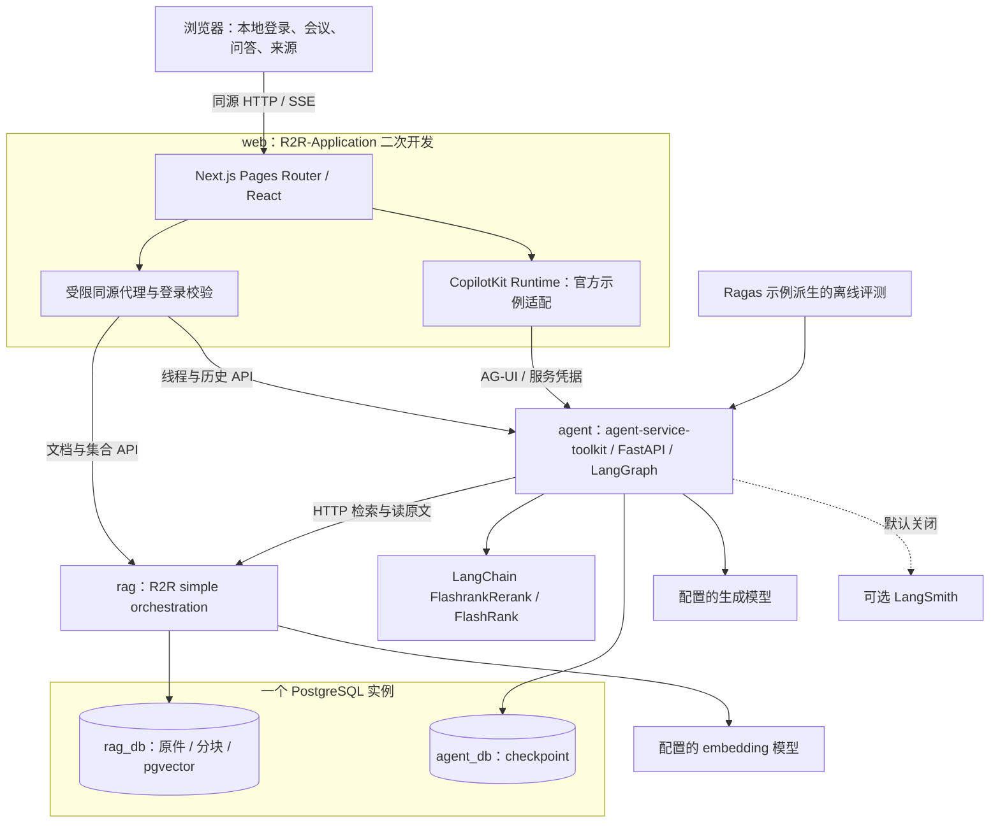
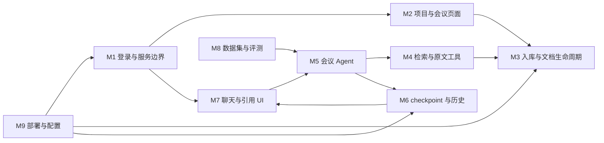
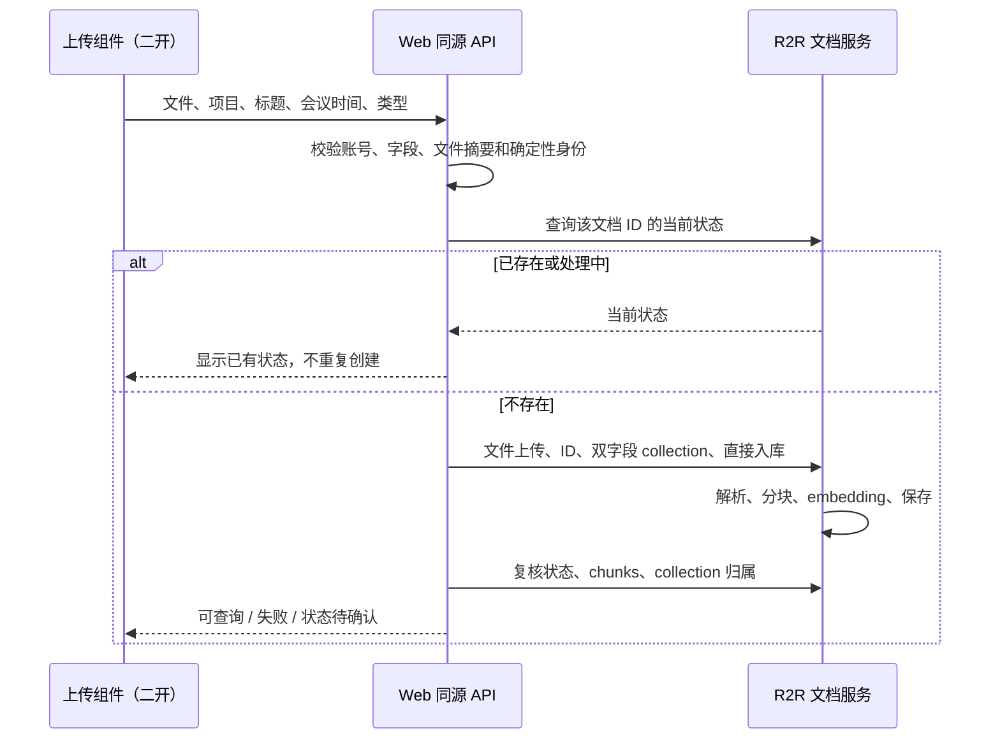
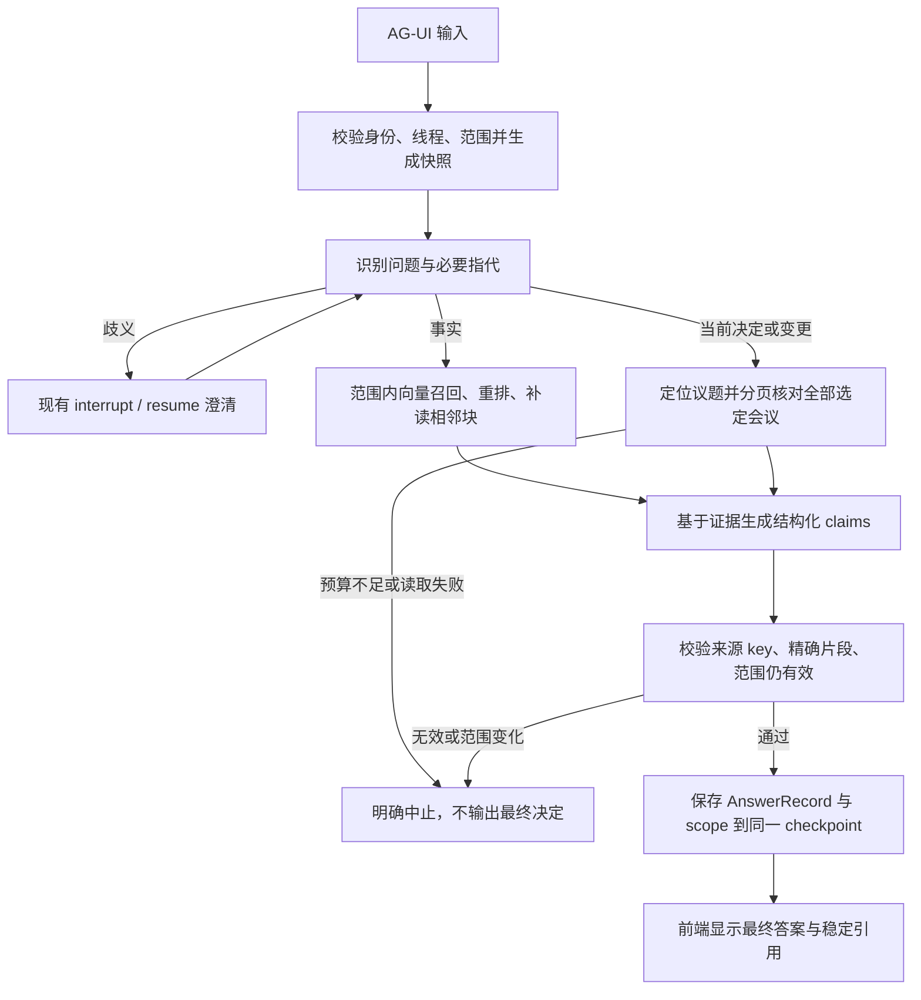

# 详细架构与装配设计

输入权威为 `docs/design-v0.1.md`。本文件将其展开为实现边界；所有 `apps/` 等代码路径当前尚不存在。

## 部署架构



仅 `web` 的 `127.0.0.1:3000` 暴露到宿主。Agent、R2R、PostgreSQL 不发布宿主端口。调试临时暴露必须显式配置为 loopback，最终验收使用发布 Compose。不增加 Redis、Hatchet、MinIO、独立向量库或独立业务 API 服务。

Agent 与 R2R 独立 Python 环境/镜像。Web 采用原前端的 Node 依赖体系；CopilotKit Runtime 装进同一 Web 进程，按官方示例适配 Pages Router，不再启动一套示例前端。

## 模块依赖



M1–M9 是现有服务中的逻辑模块，不是九个微服务。模块详细设计见 [modules.md](modules.md)。开发恢复调度属于 Harness 的外部执行环境，不进入此产品架构。

## 数据所有权

| 对象 | 唯一权威 | 读写边界 |
|---|---|---|
| 项目 | R2R collection | Web 经既有 collection API 操作 |
| 文件、会议 metadata、chunk、向量 | R2R 及 rag_db | Web 导入/读取，Agent 只通过文档与检索 HTTP API 获取 |
| 登录账号 | R2R 既有认证 | Web 验证身份；不新增用户表 |
| 对话、范围快照、AnswerRecord | LangGraph checkpoint / agent_db | Agent 写，Web 通过历史接口读；不再使用 R2R conversation |
| 引用可用性 | 当前 R2R 文档状态 | 历史快照仅保存当时证据，不自动代表当前仍可访问 |
| 评测样本与结果 | 仓库文件及受控结果目录 | 使用模拟数据，结果标明版本；不建评测服务 |

两库分别使用上游迁移，不引入 `projects`、`meetings`、`decisions`、`tasks` 等重复业务表。R2R 管原件存储；不得未经验证另接对象存储或本机目录制造第二份权威。

## 导入序列



最终 ID 和权限不信任浏览器自报；摘要可在客户端预计算用于体验，但服务端校验后再使用。保持标准 UUID/上游 ID 工具，不另建 ID 服务。网络超时先查已有状态，不把重试写成删除重建。

## 查询序列与持久化



流式生成的文字在检查前属于草稿。最终完成必须同时存在有效的 AnswerRecord 和持久化成功结果；失败时不留下看似已经完成的答案。浏览器断线不能推定服务器已取消，恢复时重读持久状态。

## 目标目录

```text
meeting-records-agent/
├── apps/
│   ├── agent/                 # 保留 agent-service-toolkit 原结构
│   │   └── src/{agents,service,schema,memory,core}/
│   ├── rag/                   # 保留 R2R 原结构，主要二开 py/core/
│   └── web/                   # 保留 R2R-Application 原结构
│       └── src/{pages,components,context,types}/
├── deployment/                # 从上游 Compose / Dockerfile 裁剪适配
├── evals/                     # 从 Ragas 示例派生
│   ├── datasets/              # 模拟会议、问题、人工核对标准答案
│   └── results/               # 原始结果默认不提交
├── tests/{contracts,e2e}/      # 集成测试；组件测试沿用各上游位置
├── docs/{usage,evidence}/     # 使用说明、去敏后的验收摘要
├── specs/001-v0.1/            # 本实施包
├── .run/v0.1/                 # 本次开发状态、调度回执、资源账；忽略提交
├── .env.example               # 实现后生成，不含真实密钥
├── upstream-lock.yaml
└── README.md
```

目录中的新辅助文件只能承载已有模块的适配、测试和配置；不是新增独立产品模块的许可证。保留每个导入项目的 LICENSE/NOTICE 和来源，不建立嵌套 `.git`，不把研究虚拟环境一起复制。

## 故障与退役

移除原 `database_search` 到 Chroma 示例库的运行依赖，Web 主链移除旧 R2R conversation/SSE 聊天依赖，禁用 R2R 的第二套 Agent、图谱及重复重排。保留有实际用途的原文和答案展示组件。退役要同时检查注册、配置、依赖、入口和 README，避免页面仍偷偷走旧后端。

导入未完成、查询未完成、开发 Agent 中断是三个不同对象。产品不增加持久入库队列；开发过程由 Harness 调度恢复，并不能据此宣称产品具备任务自动续跑能力。
