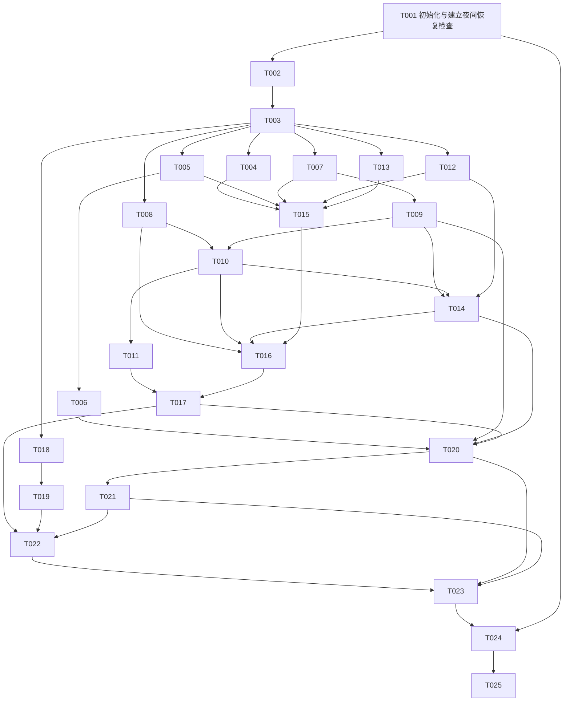

# 开发任务与依赖

所有任务初始均为未执行。编号 T001–T025 是开发任务，与产品设计中的 T01–T18 验收编号不同。依赖箭头表示前置产物已合并并可读，不是仅口头宣布开始。

`[P]` 表示在前置完成且写入/运行资源不冲突时可与同批任务并行。共享文件一律由所有者串行修改。T001 的环境检查和调度分别记结果；若只缺调度能力，允许初始化已就绪的 T002–T023 继续，A21 和最终完成仍阻塞，不能把例外写成调度成功。

## 依赖总图

## 任务索引

| 任务 | 前置 | 所有者 | 主要验收 |
|---|---|---|---|
| T001 初始化与建立夜间恢复检查 | 无，第一步 | I | A21、A22 |
| T002 引入固定上游与建立依赖基线 | T001 | I | A19、A20 |
| T003 固定接口、状态和跨端类型 | T002 | I | A02、A03、A09、A10、A16 |
| T004 部署、配置与双库装配 | T003 | I | A18、A19 |
| T005 会议入库与项目归属 | T003 | R | A01、A02、A03 |
| T006 原件清理与删除一致性 | T005 | R | A13 |
| T007 Agent 入口与身份范围边界 | T003 | A | A03、A16 |
| T008 R2R HTTP 检索与重排工具 | T003 | B | A03、A09、A15 |
| T009 持久状态与历史响应 | T007 | A | A10、A11、A12、A13 |
| T010 事实问答与引用完成流程 | T008、T009 | B | A04、A07、A09、A11 |
| T011 完整会议核对与决定归并 | T010 | B | A05、A06、A08、A15、A17 |
| T012 Web 登录与同源服务适配 | T003 | W1 | A03、A16、A19 |
| T013 会议列表与上传交互 | T003 | W2 | A01、A02、A14 |
| T014 聊天、引用与历史 UI | T009、T010、T012 | W2 | A09、A10、A11、A12 |
| T015 真实导入纵向联调 | T004、T005、T007、T012、T013 | I | A01、A02、A03 |
| T016 真实事实问答与引用联调 | T008、T010、T014、T015 | I | A04、A07、A09、A10、A11 |
| T017 决定和变更纵向联调 | T011、T016 | I | A05、A06、A08、A17 |
| T018 构造模拟会议与冻结题集 | T003 | E | A23 |
| T019 复用 Ragas 评测执行链 | T018 | E | A23 |
| T020 重启、删除与数据恢复联调 | T006、T009、T014、T017 | I | A10、A12、A13、A14、A18 |
| T021 故障、注入与边界回归 | T020 | I | A03、A15、A16、A17、A19 |
| T022 真实中文模型与冻结评测 | T017、T019、T021 | E | A23 |
| T023 全新环境安装与使用文档 | T022、T020、T021 | I | A18、A19、A20 |
| T024 逐项最终验收与交付审阅 | T023、T001 | I | A01–A23 |
| T025 交付第一版与清理恢复任务 | T024 | I | A24 |

## 可并行批次

- T003 后：T004（装配）、T005（RAG）、T007（Agent 服务）、T008（工具）、T012（Web 服务边界）、T013（会议 UI）、T018（题集）可以并行。
- T005 → T006；T007 → T009；T008 + T009 → T010 → T011；T018 → T019 各自向前推进。
- T009 + T010 + T012 完成后可启动 T014；它与 T011 可并行，但需要先取得同一契约提交。
- T015 → T016 → T017 → T020 → T021 使用同一集成栈，按顺序运行。题集/评测实现可在集成期间独立继续。
- T022 的真实评测、T023 全新安装、T024 审阅和 T025 交付依次进行。

## 任务卡

以下路径均相对仓库根目录，除既有文档外为拟引入/拟新增。实际测试命令在引入上游后填写回执；此处给验证方法，不虚构尚不存在的 test 命令。通用限制：不得修改其他角色拥有的文件、核心产品范围、验收标准或冻结题集来绕过失败。

### T001 初始化与建立夜间恢复检查

- [ ] T001 初始化与建立夜间恢复检查
- **来源**：F10、N07；验收 A21、A22。
- **前置产物**：本包及仓库基线。
- **负责人/写入范围**：I；本地 .run/v0.1/；Harness 已有调度配置。
- **实施内容与产物**：核对目录、Git 状态、输入摘要、工具和必要配置是否存在；初始化状态账。按 operations/resume.md 实际创建本次窗口的恢复检查并回读任务 ID、时区、触发时间和目标会话。
- **完成证据**：留存去敏后的初始化与调度回执；以一次受控检查验证“活跃时不重入、闲置时接续”的执行入口，不必等半小时才继续。不能通过新建一批开发会话代替恢复。
- **阻塞与保留约束**：若调度能力不可用，明确该子项 BLOCKED 并报告，初始化可用的其他工作可继续；A21 保持阻塞，不能宣称已获得无人值守保障。

### T002 引入固定上游与建立依赖基线

- [ ] T002 引入固定上游与建立依赖基线
- **来源**：N01、N06；验收 A19、A20。
- **前置产物**：T001 的完成提交/回执。
- **负责人/写入范围**：I；apps/agent/、apps/rag/、apps/web/；evals/ 示例；upstream-lock.yaml；许可文件。
- **实施内容与产物**：按固定 SHA 获取最小适用源码并保留目录和许可；记录导入清单、适配起点、锁文件与依赖问题。三个应用分离环境，不复制旧研究环境或嵌套 .git。
- **完成证据**：每个目录可追溯到上游版本；构建入口和测试入口已定位；依赖解析问题有最小补丁及原因。evals 本阶段只引入基础示例，题集由 T018 管。
- **阻塞与保留约束**：网络失败可分项目继续；未拿到完整依赖前只能报告源码就绪，不能宣称服务启动。核心基座必须更换时先提交影响说明。

### T003 固定接口、状态和跨端类型

- [ ] T003 固定接口、状态和跨端类型
- **来源**：F01–F09、N02–N04；验收 A02、A03、A09、A10、A16。
- **前置产物**：T002 的完成提交/回执。
- **负责人/写入范围**：I；本包 contracts/；apps/agent/src/schema/schema.py；apps/web/src/types/meeting-contracts.ts；tests/contracts/。
- **实施内容与产物**：核对 C01–C08 与实际源码；固定 UUID/规范化测试向量、范围/来源/AnswerRecord 类型、错误映射和 AG-UI 状态投影。用官方接口做最小序列化与往返检查。
- **完成证据**：前后端共用同一语义、fixture 能被两端解析；身份/范围/来源伪造样例预先固定。发布契约提交后才让消费者并行改造。
- **阻塞与保留约束**：单纯 API 形态可适配；若协议不能表达已承诺行为，不让两端各自发明替代契约。

### T004 部署、配置与双库装配

- [ ] T004 [P] 部署、配置与双库装配
- **来源**：N02、N05、N06；验收 A18、A19。
- **前置产物**：T003 的完成提交/回执。
- **负责人/写入范围**：I；deployment/；根 .env.example；根使用说明；全局依赖与构建装配。
- **实施内容与产物**：基于上游 Compose/Dockerfile 裁剪成 web/agent/rag/PostgreSQL；建双库双账号、卷和健康检查；填入真实设置对象认可的配置键；锁定依赖。
- **完成证据**：服务端口、迁移顺序、无密钥模板和停止保数据流程明确。组件尚未集成时只记录基础栈结果，A18 等 T023 完整安装验证。
- **阻塞与保留约束**：数据库/容器能力不足时记录环境阻塞，其他不依赖运行栈的组件和数据工作继续。

### T005 会议入库与项目归属

- [ ] T005 [P] 会议入库与项目归属
- **来源**：F01、F02、N02；验收 A01、A02、A03。
- **前置产物**：T003 的完成提交/回执。
- **负责人/写入范围**：R；apps/rag/py/core/main/api/v3/documents_router.py；services/ingestion_service.py；相关配置与测试。
- **实施内容与产物**：裁剪入库选项，映射会议字段与 chunk metadata；核对双字段 collection 归属；保持标准文件解析和 embedding 路径，支持状态查询与已有失败重试。
- **完成证据**：真实 R2R 中至少一个中文 TXT 和 Markdown 通过；原件、分块、metadata、归属可逐项核对；同名、重复和并发重试不串文档。
- **阻塞与保留约束**：无 embedding 配置可先做契约/组件测试，真实入库结论仍待配置；不得用手写 chunks 绕开文件入口验收。

### T006 原件清理与删除一致性

- [ ] T006 原件清理与删除一致性
- **来源**：F09、N02；验收 A13。
- **前置产物**：T005 的完成提交/回执。
- **负责人/写入范围**：R；apps/rag/py/core/main/services/management_service.py；providers/file/postgres.py；相关 router 和测试。
- **实施内容与产物**：在既有删除主链连接 file provider 的清理能力；核对部分失败、重试、文档/块/文件可用性，不增加删除服务。
- **完成证据**：删除后检索、文档读取与原件下载均不可获得该记录；中途失败显示未完成且能按当前状态重试；其他记录不受影响。
- **阻塞与保留约束**：不能只凭 DELETE 返回 success 或文档表不存在判断全清理；必要修复交 R 所有者串行实施。

### T007 Agent 入口与身份范围边界

- [ ] T007 [P] Agent 入口与身份范围边界
- **来源**：F02、N03、N05；验收 A03、A16。
- **前置产物**：T003 的完成提交/回执。
- **负责人/写入范围**：A；apps/agent/src/service/agui.py；service/service.py；schema/schema.py；相关测试。
- **实施内容与产物**：对白名单 forwardedProps、线程、账号和客户端状态做校验；绑定服务器身份；保留标准 AG-UI 事件，禁止 RAW 和内部提示透传。
- **完成证据**：伪造 user_id/configurable/source/state、访问其他线程和越界对象均被阻止；合法输入可到达图入口。
- **阻塞与保留约束**：不扩大共享服务凭据权限；需要改 C02/C05 时先由 I 统一契约。

### T008 R2R HTTP 检索与重排工具

- [ ] T008 [P] R2R HTTP 检索与重排工具
- **来源**：F03、F06、N03；验收 A03、A09、A15。
- **前置产物**：T003 的完成提交/回执。
- **负责人/写入范围**：B；apps/agent/src/agents/tools.py；必要的同工具组辅助文件；对应测试。
- **实施内容与产物**：二开 database_search：范围过滤、HTTP 调用、LangChain/FlashRank 重排；适配 chunks 分页及相邻块读取，保持完整来源标识，移除 Chroma 示例运行依赖。
- **完成证据**：固定输入可证明重排前后 ID 不丢失、越界结果被拒绝、全文分页可读完；服务错误与无结果区分。真实接口由 T016 复验。
- **阻塞与保留约束**：无真实服务先用可控响应验证契约，并明确 fixture；不能把这种测试算中文效果或最终服务验收。

### T009 持久状态与历史响应

- [ ] T009 持久状态与历史响应
- **来源**：F07、F08、F09；验收 A10、A11、A12、A13。
- **前置产物**：T007 的完成提交/回执。
- **负责人/写入范围**：A；apps/agent/src/service/service.py；schema/schema.py；memory/postgres.py；对应测试。
- **实施内容与产物**：扩展 checkpoint 状态和 ChatHistory 映射，恢复范围、AnswerRecord、稳定引用和完成状态；线程读取绑定账号；保留已有 saver。
- **完成证据**：序列化往返及 PostgreSQL 重连后记录一致；未完成轮次不会恢复成完成；无第二套聊天表。产品浏览器恢复由 T020 复验。
- **阻塞与保留约束**：不得只恢复消息文本；本任务与 T007 共享文件，因此严格按依赖串行。

### T010 事实问答与引用完成流程

- [ ] T010 事实问答与引用完成流程
- **来源**：F03、F06、F07、N03；验收 A04、A07、A09、A11。
- **前置产物**：T008、T009 的完成提交/回执。
- **负责人/写入范围**：B；apps/agent/src/agents/rag_assistant.py；图注册/提示词；对应测试。
- **实施内容与产物**：扩展既有图状态、问题理解、范围快照、检索、结构化 claims、来源检查和保存；必要澄清沿用 interrupt/resume；历史只用于指代。
- **完成证据**：同一图完成事实问题并保存 C04；无依据不补写，来源检查失败/保存失败不能发布完成结果。
- **阻塞与保留约束**：服务/模型失败不得归为无证据；模型结构修复最多一次，其他预算明确有界。

### T011 完整会议核对与决定归并

- [ ] T011 完整会议核对与决定归并
- **来源**：F04、F05、N04；验收 A05、A06、A08、A15、A17。
- **前置产物**：T010 的完成提交/回执。
- **负责人/写入范围**：B；apps/agent/src/agents/rag_assistant.py；同图节点及提示词；对应测试。
- **实施内容与产物**：在同一图增加决定/变化分支；分页读取全部选定会议，逐场提取相关证据，按可靠时间归并；记录 coverage 和预算中止。
- **完成证据**：提议、确认、改动、缺失、冲突各有受控案例；不漏读后给最终决定；同日未知顺序不按上传时间裁定。
- **阻塞与保留约束**：超过预算要求缩小范围，不偷偷改为 top-k；与 T010 共享图文件，不能同时写。

### T012 Web 登录与同源服务适配

- [ ] T012 [P] Web 登录与同源服务适配
- **来源**：F02、F08、N05；验收 A03、A16、A19。
- **前置产物**：T003 的完成提交/回执。
- **负责人/写入范围**：W1；apps/web/src/pages/api/；src/context/UserContext.tsx；相关测试。
- **实施内容与产物**：复用已有登录与官方 Runtime 示例，适配 Pages Router；允许名单转发 R2R/Agent，绑定账号；关闭注册入口及可绕过的同源注册路径。
- **完成证据**：合法登录可调用受限接口；未经登录、任意 URL、伪造身份和禁用路径被拒绝；凭据只在服务端。
- **阻塞与保留约束**：全局 package/lock/_app 需求提交 I 合并；不得私自并行修改这些共享文件。

### T013 会议列表与上传交互

- [ ] T013 [P] 会议列表与上传交互
- **来源**：F01、F02、F09；验收 A01、A02、A14。
- **前置产物**：T003 的完成提交/回执。
- **负责人/写入范围**：W2；apps/web/src/pages/documents.tsx；collection 页面；上传/列表组件；相关 UI 测试。
- **实施内容与产物**：增加会议字段、项目/会议范围选择和真实状态展示；适配 C01/C02，替换仅按文件名的身份；上传、删除和重试使列表缓存失效。
- **完成证据**：模拟接口下交互可完整复现，错误提示落到文件/字段；真入库与状态由 T015 验证；未就绪文档不进入问答。
- **阻塞与保留约束**：不修改聊天 answer/result，避免与 T014 冲突；需要公共组件变化先交 I。

### T014 聊天、引用与历史 UI

- [ ] T014 [P] 聊天、引用与历史 UI
- **来源**：F06、F07、F08；验收 A09、A10、A11、A12。
- **前置产物**：T009、T010、T012 的完成提交/回执。
- **负责人/写入范围**：W2；apps/web/src/pages/chat.tsx；ChatDemo/answer.tsx、result.tsx、SearchResults、documentDialogInfo；对应 UI 测试。
- **实施内容与产物**：复用原组件和官方 headless-chat，展示范围、进度、完成答案及历史；稳定映射引用，按 ID/order 定位原文；移除旧 R2R 聊天输入和 SSE 运行依赖。
- **完成证据**：同文异源、重排后顺序变化、跨页片段、刷新恢复均正确；键盘可打开来源，窄屏可用；终态失败不显示已完成答案。
- **阻塞与保留约束**：T013/T014 同角色可串行；若分两人则按明确文件清单拆分，公用文件不得同时改。

### T015 真实导入纵向联调

- [ ] T015 真实导入纵向联调
- **来源**：F01、F02；验收 A01、A02、A03。
- **前置产物**：T004、T005、T007、T012、T013 的完成提交/回执。
- **负责人/写入范围**：I；tests/e2e/ 导入集成用例；docs/evidence/ 导入摘要。
- **实施内容与产物**：使用独占集成栈完成登录、创建项目、TXT/Markdown 上传、状态刷新、分块查看和跨项目隔离；故障回到模块所有者修复。
- **完成证据**：前端操作与真实 R2R 数据一致，归属及原文件可核对；重复/超时后先查状态，不产生双份。
- **阻塞与保留约束**：未具备真实 embedding 则此闭环阻塞，但可继续其他不依赖模型的工作；禁止 mock 过关。

### T016 真实事实问答与引用联调

- [ ] T016 真实事实问答与引用联调
- **来源**：F03、F06、F07；验收 A04、A07、A09、A10、A11。
- **前置产物**：T008、T010、T014、T015 的完成提交/回执。
- **负责人/写入范围**：I；tests/e2e/ 问答引用集成用例；docs/evidence/ 问答摘要。
- **实施内容与产物**：使用真实检索、重排、模型和浏览器串通问题到引用；核对 Web/Runtime/Agent/R2R 的 ID、范围和消息终态。
- **完成证据**：从 UI 点击每项引用能到正确原文；有服务调用和原件对照证据；旧聊天链路不参与。
- **阻塞与保留约束**：没有模型配置时只能保留协议验证结果；最终真实链路验收保持阻塞。

### T017 决定和变更纵向联调

- [ ] T017 决定和变更纵向联调
- **来源**：F04、F05、N04；验收 A05、A06、A08、A17。
- **前置产物**：T011、T016 的完成提交/回执。
- **负责人/写入范围**：I；tests/e2e/ 决定核对用例；docs/evidence/ 决定摘要。
- **实施内容与产物**：导入多次会议，用真实模型演示提议与确认、明确变更、原因缺失、逆序上传、同日冲突和范围覆盖。
- **完成证据**：每个决定结论有前后证据和覆盖记录，最后一场仅提出建议时不覆盖旧确认；原文未写原因时明确未知。
- **阻塞与保留约束**：发现质量问题先用调试集和提示词/预算修复；不能修改冻结标准答案迁就结果。

### T018 构造模拟会议与冻结题集

- [ ] T018 [P] 构造模拟会议与冻结题集
- **来源**：F10；验收 A23。
- **前置产物**：T003 的完成提交/回执。
- **负责人/写入范围**：E；evals/datasets/；数据集说明及划分清单。
- **实施内容与产物**：制作 3 个模拟项目、18 份会议、36 题，12 调试/24 冻结；逐题核对标准原文、证据跨度、可接受结论和禁止推断；单独标出最小三份演示文件。
- **完成证据**：题目覆盖 F01–F09 的业务语义与跨项目干扰；所有冻结项有版本摘要；不使用真实私人会议。
- **阻塞与保留约束**：不能用被测模型自动输出直接当真值；数据矛盾需修正后重新冻结并说明影响。

### T019 复用 Ragas 评测执行链

- [ ] T019 [P] 复用 Ragas 评测执行链
- **来源**：F10、N06；验收 A23。
- **前置产物**：T018 的完成提交/回执。
- **负责人/写入范围**：E；evals/ 的 Ragas 示例适配；配置和结果格式；相关评测检查。
- **实施内容与产物**：扩展官方示例加载数据、调用产品并记录证据/答案/错误；实现三组相同题集对照和通用/业务指标输出，记录模型与版本。
- **完成证据**：受控小样例能证明计数和结果格式正确；真实跑分在 T022，报告必须区分替身和真实数据。
- **阻塞与保留约束**：不要新增评测服务；真实模型阻塞不影响结果格式和示例适配。

### T020 重启、删除与数据恢复联调

- [ ] T020 重启、删除与数据恢复联调
- **来源**：F08、F09、N02；验收 A10、A12、A13、A14、A18。
- **前置产物**：T006、T009、T014、T017 的完成提交/回执。
- **负责人/写入范围**：I；tests/e2e/ 生命周期用例；备份恢复说明和证据。
- **实施内容与产物**：独占集成栈执行正常停启、旧回答来源、删除与部分失败、all_ready/explicit 新增差异；按 PostgreSQL 工具做双库备份恢复演练。
- **完成证据**：记录/范围/来源恢复，删除后新查询不使用旧证据，旧回答来源失效；备份恢复在隔离资源中验证，不覆盖唯一原卷。
- **阻塞与保留约束**：禁止与其他联调并发清库；产品断电任意续跑不属于该验收，也不能被宣传为已实现。

### T021 故障、注入与边界回归

- [ ] T021 故障、注入与边界回归
- **来源**：N03、N04、N05；验收 A03、A15、A16、A17、A19。
- **前置产物**：T020 的完成提交/回执。
- **负责人/写入范围**：I；tests/contracts/ 与 tests/e2e/ 的故障边界用例；去敏证据。
- **实施内容与产物**：验证超时、限流、失效凭据、R2R 失败、部分分页失败、预算耗尽、伪造来源/身份、原文提示注入及发布前删除。
- **完成证据**：错误分类不混成无证据；无越范围引用/虚构 key；生成失败不冒充完成；公开配置不带密钥。
- **阻塞与保留约束**：修复回原模块所有者，修改后只复跑受影响和必须回归的测试，不为了绿灯移除断言。

### T022 真实中文模型与冻结评测

- [ ] T022 真实中文模型与冻结评测
- **来源**：F10、N06；验收 A23。
- **前置产物**：T017、T019、T021 的完成提交/回执。
- **负责人/写入范围**：E；evals/results/；docs/evidence/evaluation-summary.md；发布配置记录。
- **实施内容与产物**：锁定生成、embedding、重排模型及预算；在同一冻结 24 题上运行纯向量、向量+重排、决定类完整核对三组；记录成本、耗时、错误和分母。
- **完成证据**：逐题输入输出/证据、通用与业务指标、失败样例和配置可复查；硬性案例通过，质量结论不夸大；36 题资产与 24 题冻结运行明确区分。
- **阻塞与保留约束**：缺凭据/下载/额度必须记录阻塞，不偷换模型或假造分数；供应商不可用时仅在已授权配置内选择并完整记录。

### T023 全新环境安装与使用文档

- [ ] T023 全新环境安装与使用文档
- **来源**：N05、N06；验收 A18、A19、A20。
- **前置产物**：T022、T020、T021 的完成提交/回执。
- **负责人/写入范围**：I；README.md；docs/usage/；.env.example；deployment/ 发布装配；验收证据。
- **实施内容与产物**：在干净 worktree/克隆和独立数据卷按文档安装；完成从配置到 UI 闭环；说明模型下载、运行资源、正常停止、备份恢复、删除数据及已知限制。
- **完成证据**：无研究目录或开发机隐式文件依赖；配置模板来自真实设置；新环境按所列命令成功；应用功能未完成时不删状态说明冒充发布。
- **阻塞与保留约束**：容器缓存可以复用但必须记录，不能把已有数据库中的结果冒充全新初始化。

### T024 逐项最终验收与交付审阅

- [ ] T024 逐项最终验收与交付审阅
- **来源**：F01–F10、N01–N07；验收 A01–A23。
- **前置产物**：T023、T001 的完成提交/回执。
- **负责人/写入范围**：I；本包 acceptance/ 实际结果副本；docs/evidence/；交付说明。
- **实施内容与产物**：按 A01–A23 逐条检查最新提交的证据，核对每个任务与验收映射；复核许可、旧链路退出、依赖锁、模拟数据标识和未完成项。
- **完成证据**：每项为 PASS/FAIL/BLOCKED，有版本、命令、真实/替身标记、证据定位；不能只有“测试全绿”一句话。
- **阻塞与保留约束**：任何硬性项或真实链路阻塞都不能输出 v0.1 完成；窗口截止不改变判定。

### T025 交付第一版与清理恢复任务

- [ ] T025 交付第一版与清理恢复任务
- **来源**：N06、N07；验收 A24。
- **前置产物**：T024 的完成提交/回执。
- **负责人/写入范围**：I；Git 提交；docs/usage/ 与 docs/evidence/ 最终入口；本地调度回执。
- **实施内容与产物**：保留可用运行入口和明确操作说明，形成最终本地提交；清理本次恢复检查并回读确认，整理已完成项、真实测试、已知限制和资源状态。
- **完成证据**：用户能按文档体验；本次定时检查无遗留触发，结果可追到提交；既有远端如未推送明确写明，是否推送遵循用户实际发出的指令。
- **阻塞与保留约束**：任务提前完成可立即清理；09:30 到达而未完成时同样结束本次定时窗口但保留准确进展，不以清理调度代替产品交付。

## 状态更新

执行者将领用、提交、证据、阻塞和下一步写入 `.run/v0.1/status.md`，I 汇总后更新任务勾选。勾选表示任务产物有证据，不替代 A01–A24 的最终判定。工作者回执各写独立文件，不并发覆盖总账。
